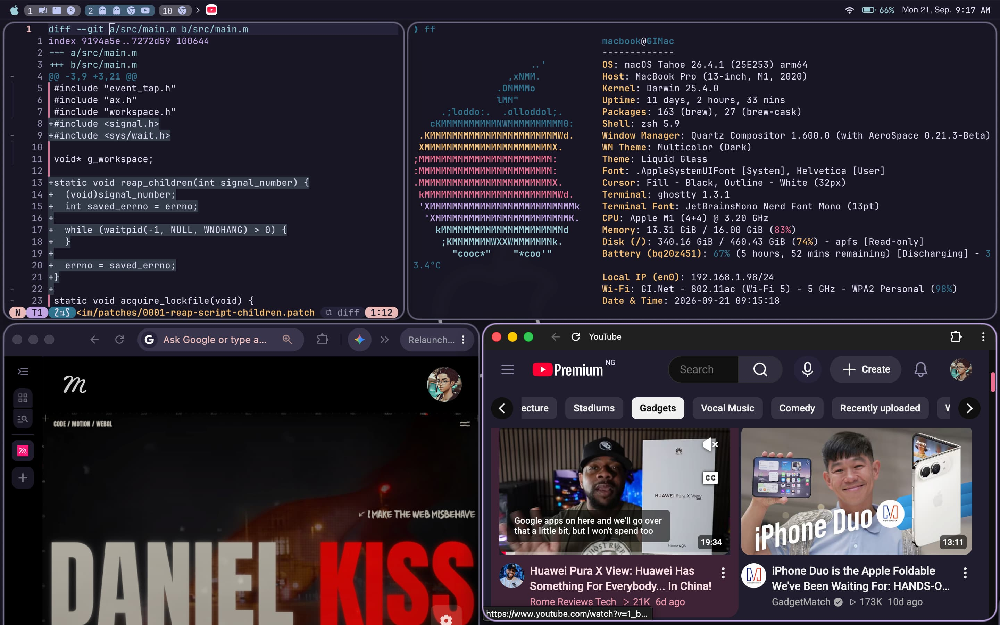
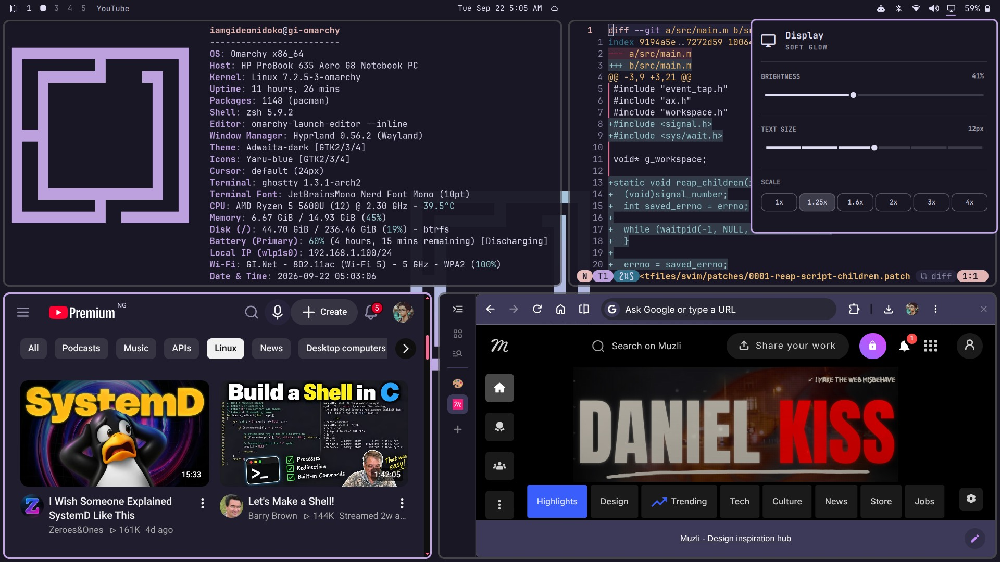

# dotfiles

Personal dotfiles for a seamless macOS and Omarchy workspace built for focused,
high-leverage work.

## Clone

```sh
git clone git@github.com:iamgideonidoko/dotfiles.git ~/dotfiles
cd ~/dotfiles
```

## macOS



```sh
make macos-setup
```

macOS uses [OmniWM](./omniwm/README.md) with Omarchy-style shortcuts and motion.
Use `make omniwm` to activate it or `make aerospace` to restore the legacy desktop.

## Omarchy



```sh
make omarchy-setup
```
